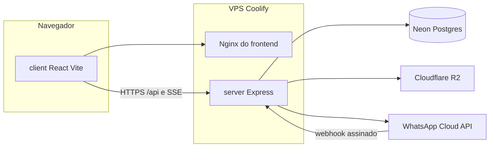

# Arquitetura

Plataforma multi-tenant. O frontend e a API são containers separados. O banco é Postgres (Neon) com schema compartilhado e RLS. A pasta do código continua `client/` e `server/`: o deploy no Coolify, os Dockerfiles e os workflows citam esses caminhos.

## Pastas

| Pasta | Função |
|---|---|
| `client/` | SPA React 18, Vite e Tailwind. Em dev o Vite encaminha `/api` para a porta 3001. |
| `server/` | API Express. Processo persistente: SSE por LISTEN/NOTIFY, fila, campanha e IA. |
| `server/db/migrations/` | SQL numerado. Roda inteiro a cada deploy. Não se edita migração já aplicada. |
| `server/api/` | Rotas do painel da empresa, com RBAC. |
| `server/webhook/` | Entrada da Meta. O evento bruto é gravado antes do ACK. |
| `server/ia/` | Agente: três fases de runtime, perfil, ferramentas, áudio e imagem. |
| `server/bot/` | Fluxos determinísticos. |
| `server/fila/` | Distribuição least-loaded e round-robin. |
| `server/operador/` | Painel interno. Contexto de tenant nulo, explícito. |
| `server/realtime/` | Hub SSE. Usa a conexão direta do Postgres, sem pooler. |
| `docs/` | Contratos, operação e decisões. |

## Duas sessões

O painel da empresa assina JWT com `JWT_SECRET` (`token`). O operador assina com `OPERADOR_JWT_SECRET` (`token_operador`). Os clientes HTTP são `client/src/services/api.js` e `client/src/services/apiOperador.js`. Um token não vale no outro painel.

O tenant da requisição sai só do JWT, em `server/auth/middleware.js`. Query, header e body não escolhem empresa. A query de dado de tenant roda dentro de `comTenant()`, que abre transação, assume o role da aplicação e grava `app.current_tenant_id` só naquela transação — o pooler do Neon está em modo transação.

Tabela nova entra no bloco RLS `isolamento_tenant` e ganha `UNIQUE (tenant_id, id)`.

## Mensagem

1. A Meta chama o webhook. A assinatura confere com o segredo do app.
2. O payload é gravado. Só então a API responde 200.
3. O processamento cria ou atualiza contato, conversa e mensagem.
4. Bot, fila ou IA reagem depois do commit. Efeito que precisa sobreviver a um restart nasce no outbox, na mesma transação.
5. O inbox recebe o fato por NOTIFY. O navegador escuta por SSE com um ticket de curta duração, não com o JWT na query.

A Meta não manda o tenant. O número (`phone_number_id`) resolve a empresa. Há um webhook da plataforma e um caminho por empresa (`/webhook/<32 hex>`), cada um com o segredo do app correspondente.

## IA

O runtime em `server/ia/runtime.js` é dividido em três fases para não segurar duas conexões do pool na mesma requisição. A camada 1 do prompt (`BASE_SISTEMA` em `server/ia/perfilStore.js`) não é editável pelo admin: anti-alucinação, escopo, anti-injeção e sigilo.

## O que não viaja para telemetria

Sentry (`@sentry/node` na API, `@sentry/react` no navegador) e PostHog (só no navegador, só com sessão) estão descritos em `docs/operacao.md`. Corpo, header, cookie e query não entram. Mensagem de WhatsApp não entra.
